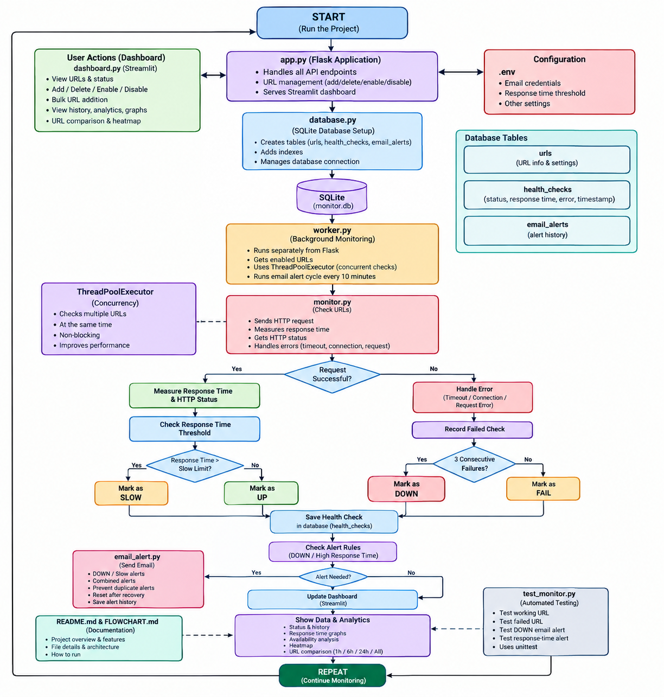

# URL Health Monitoring Tool

## About the Project

This is a Python and Flask based URL Health Monitoring Tool that I made to check the health of websites and APIs.

The application checks URLs at regular intervals and stores the results in a SQLite database. It records information such as HTTP status code, response time, current status, errors and previous health-check results.

I used Streamlit to create the dashboard so that the monitoring results can be viewed easily.

The project also uses a background worker so that URL monitoring does not block the Flask application.

## Features

The main features of this project are:

* Add website or API URLs

* Delete URLs

* Enable or disable URL monitoring

* Set a monitoring interval for each URL

* Set a slow response-time threshold for each URL

* Check URL availability

* Check HTTP status codes

* Measure response time

* Detect slow URLs

* Handle timeout and connection errors

* Mark a URL as DOWN after 3 continuous failures

* Store health-check history

* Calculate average, minimum and maximum response time

* Track successful and failed checks

* Monitor URLs in the background

* Check multiple URLs using ThreadPoolExecutor

* Prevent one slow or failed URL from stopping other URL checks

* Provide REST APIs

* Display monitoring results using Streamlit

* Add multiple URLs using bulk add

* Automatically refresh the dashboard

* View recent health-check history

* View response-time statistics

* View response-time graph

* Compare response times of multiple URLs

* Show actual check time on the graph

* Show execution time in seconds on the graph

* Show check details when viewing graph points

* View last 1 hour monitoring data

* View last 6 hours monitoring data

* View last 24 hours monitoring data

* View all monitoring history

* View overall 24-hour monitoring analysis

* View availability information

* View availability heatmap

* Compare availability of multiple URLs

* Run automated tests

* Store monitoring data in SQLite

* Use database indexes for health-check queries

* Support restarting the background worker without losing stored history

* Send automatic email alerts

* Send DOWN alerts after 3 continuous failures

* Send high response-time alerts

* Combine multiple DOWN URLs into one email

* Combine multiple high response-time URLs into one email

* Check email alerts every 10 minutes

* Prevent repeated alerts for the same ongoing problem

* Reset alert state when a URL recovers

* Store email alert history in SQLite

## Technologies Used

I used the following technologies in this project:

* Python

* Flask

* SQLite

* Requests

* Streamlit

* ThreadPoolExecutor

* unittest

* python-dotenv

* SMTP

* Git

* GitHub

## Project Workflow



## Project Files

### app.py

This file contains the Flask application.

It also contains the REST API routes used for URL management and health information.

The APIs can be used to add, delete and manage URLs and to view current and historical health information.

### database.py

This file creates and initializes the SQLite database.

It creates the required tables and indexes used by the application.

The database is created locally as `monitor.db`.

It also contains the `email_alerts` table used to store email alert history.

### monitor.py

This file contains the main URL checking functions.

It sends requests to the URLs, measures response time and handles different request errors.

It also stores health-check results in the database.

The monitoring logic also checks consecutive failures so that a URL can be marked as DOWN after 3 continuous failures.

It also checks the configured slow response-time threshold for each URL.

### worker.py

This file runs the URL monitoring in the background.

It checks enabled URLs according to their configured monitoring interval.

It uses ThreadPoolExecutor to check multiple URLs separately.

It also manages the 10-minute email alert cycle.

The worker checks the latest DOWN and high response-time URLs and sends combined alerts.

It also prevents repeated alerts for the same ongoing problem.

### dashboard.py

This file contains the Streamlit dashboard.

It displays the current URL status, response time, HTTP status, errors, monitoring status and last check time.

It also provides options to add, delete, enable, disable and bulk add URLs.

The dashboard automatically refreshes so that updated monitoring information can be seen without manually refreshing the page.

The dashboard also contains monitoring history, response-time statistics and graphs.

It also contains overall 24-hour analysis and availability heatmap.

### test_monitor.py

This file contains the automated tests for the monitoring functions.

The tests check both a working URL and a failed URL.

It also contains tests for email alert functions.

### monitor.db

This is the SQLite database file.

It stores the configured URLs and the health-check history.

It also stores email alert history.

### Some_Basic_facts.md

This file contains the main engineering and design decisions of the project.

It explains why a separate background worker was used, why ThreadPoolExecutor was selected and how the application handles slow or failed URLs.

It also explains database indexing, restart behavior and handling multiple URLs.

It also contains information about the monitoring and alert design.

### requirements.txt

This file contains the external Python packages required by the project.

The main packages are:

* Flask

* Requests

* Streamlit

* python-dotenv

Python built-in modules such as sqlite3, unittest, datetime and concurrent.futures do not need to be added to this file.

### .env

This file contains the email configuration used by the automatic email alert system.

It contains the email sender, email password, receiver email and high response-time threshold.

The `.env` file is kept private and is not uploaded to GitHub.

### .gitignore

This file contains files and folders that should not be uploaded to GitHub.

For example, the virtual environment, local SQLite database and `.env` file are ignored.

## Database

I used SQLite because the project is running locally and SQLite is simple to set up without requiring a separate database server.

The database contains three main tables.

### urls

This table stores the URLs that are being monitored.

The main fields are:

* id

* url

* name

* enabled

* interval

* slow_threshold

The `interval` field stores how often the URL should be checked.

The `slow_threshold` field stores the response-time limit for that URL.

This allows different URLs to have different slow response-time limits.

### health_checks

This table stores the result of every health check.

The main fields are:

* id

* url_id

* timestamp

* status

* http_status

* response_time

* error

I also added indexes for the URL ID and timestamp columns in the `health_checks` table.

These indexes can help when health-check history needs to be searched for a particular URL or time.

### email_alerts

This table stores information about automatic email alerts.

The main fields are:

* id

* timestamp

* alert_type

* url_name

* url

* message

I also added an index for the timestamp column.

This helps when the latest email alerts need to be viewed.

## URL Status

The application uses different statuses based on the result of a health check.

### UP

The URL responded successfully and the response time was within the configured slow threshold.

### SLOW

The URL responded successfully but took more time than the configured slow threshold.

The default slow threshold is 2 seconds.

The threshold can also be changed for individual URLs.

### FAIL

The URL could not be checked because of a timeout, connection problem or another request error.

### DOWN

If a URL fails 3 times continuously, the application marks it as DOWN.

## Background Monitoring

I used a separate background worker for URL monitoring so that the Flask application does not have to wait for health checks to finish.

The background monitoring code is present in `worker.py`.

For checking multiple URLs, I used Python's ThreadPoolExecutor.

This allows multiple URL checks to run separately. Because of this, one slow or unavailable URL should not stop the monitoring of the other URLs.

The worker only checks URLs that are enabled and uses the monitoring interval stored for each URL.

A request timeout is also used so that the worker does not wait forever for a URL that is not responding.

The worker also has a separate 10-minute email alert cycle.

More details about this design are explained in `Some_Basic_facts.md`.

## Error Handling

The application handles common problems that can happen while checking a URL.

These include:

* Request timeout

* Connection failure

* Request errors

* Unexpected errors

If one URL fails, the error is saved in the database and the monitoring process continues with the other URLs.

The application uses a request timeout so that a slow or unavailable website does not block the monitoring process for an unlimited amount of time.

## Bulk URL Monitoring

The dashboard supports adding multiple URLs using the bulk add feature.

This makes it easier to add and monitor multiple websites or APIs without adding every URL separately.

The added URLs can then be monitored by the background worker.

Each URL can have its own monitoring interval and slow response-time threshold.

## Dashboard

I used Streamlit for the dashboard.

The dashboard shows information such as:

* Total number of URLs

* Healthy URLs

* Down URLs

* URL name

* URL address

* Current status

* HTTP status

* Response time

* Monitoring status

* Monitoring interval

* Slow threshold

* Error information

* Last check time

* Health-check history

* Average response time

* Minimum response time

* Maximum response time

* Successful checks

* Failed checks

The dashboard also allows URLs to be:

* Added

* Deleted

* Enabled

* Disabled

* Added in bulk

The dashboard automatically refreshes every 10 seconds so that new monitoring results can be displayed.

## Monitoring Analytics

The dashboard provides monitoring analytics for a selected URL.

It shows response-time information and health-check history.

The response-time graph shows:

* Actual Check Time on the X axis

* Execution Time in seconds on the Y axis

* A continuous response-time line

* Individual check points

When a graph point is selected or hovered over, information such as the following can be viewed:

* Check Time

* Status

* Execution Time

* HTTP Status

* Error

The dashboard also provides different time ranges for viewing history.

These include:

* Last 1 hour

* Last 6 hours

* Last 24 hours

* All history

A URL comparison graph is also available to compare response times between multiple monitored URLs.

## 24 Hour Overall Analysis

The dashboard also provides an overall analysis for the last 24 hours.

This helps to understand the overall health of the monitored URLs.

The analysis includes information such as:

* Total checks

* Successful checks

* Failed checks

* DOWN checks

* Average response time

* Overall availability

The 24-hour analysis provides a quick view of the monitoring performance.

## Availability Heatmap

The dashboard also contains an availability heatmap.

The heatmap shows the availability of monitored URLs over time.

It helps to identify:

* URLs with frequent failures

* Periods with lower availability

* URLs that are mostly healthy

* Changes in availability over time

The heatmap makes it easier to understand URL availability without checking every health-check record separately.

## URL Comparison

The dashboard also provides URL comparison.

It can be used to compare the response times of multiple monitored URLs.

This helps identify which URLs are responding faster and which URLs are taking more time.

Availability information can also be compared between URLs.

## Email Alerts

The project includes an automatic email alert system using SMTP.

The email system can send alerts for:

* DOWN URLs

* High response-time URLs

### DOWN Alert

When a URL fails 3 continuous checks, it is marked as DOWN.

The system can send an email containing:

* URL name

* URL address

* Status

* Failure count

### High Response Time Alert

The system can send an email when a URL takes more time than the configured high response-time limit.

The email contains information such as:

* URL name

* URL address

* Status

* Response time

* Threshold

## Combined Email Alerts

The email system supports combined alerts.

If multiple URLs are DOWN during an alert cycle, they are included in one combined email.

For example:

```text
Website A → DOWN
Website B → DOWN
Website C → DOWN
```

Instead of sending three separate emails, the system sends one email containing all the DOWN URLs.

The same approach is used for high response-time URLs.

This reduces unnecessary emails.

## 10 Minute Email Alert Cycle

The background worker checks the email alert conditions every 10 minutes.

The alert interval is:

```python
ALERT_INTERVAL = 600
```

600 seconds is equal to 10 minutes.

The normal URL checking interval and email alert interval are separate.

For example, a URL can be checked every 60 seconds while email alerts are reviewed every 10 minutes.

## Duplicate Alert Prevention

The email system prevents repeated alerts for the same ongoing problem.

For example:

```text
URL becomes DOWN
      ↓
DOWN email sent
      ↓
10 minutes later
      ↓
URL is still DOWN
      ↓
No new email
      ↓
10 minutes later
      ↓
URL is still DOWN
      ↓
No new email
```

This prevents email spam for the same ongoing DOWN problem.

The same logic is used for high response-time alerts.

## Alert Recovery

When a URL becomes healthy again, its alert state is reset.

For example:

```text
URL DOWN
   ↓
Email sent
   ↓
URL remains DOWN
   ↓
No repeated email
   ↓
URL becomes UP
   ↓
Alert state reset
   ↓
URL becomes DOWN again
   ↓
New email sent
```

This allows a new alert to be sent for a new failure after recovery.

## Email Alert History

Information about sent email alerts is stored in the `email_alerts` table.

This includes:

* Alert type

* URL name

* URL

* Message

* Timestamp

The dashboard can also show the latest email alert information.

## REST API

The project also provides REST APIs using Flask.

The APIs are used for managing URLs and viewing current and previous health-check information.

The API can be used to:

* Add URLs

* Delete URLs

* Enable or disable URLs

* View configured URLs

* View current health information

* View health-check history

* View monitoring statistics

They can be tested using a browser, curl or another API testing tool.

## Automated Testing

I added automated tests using Python's unittest module.

I run the tests using:

```powershell
python -m unittest test_monitor.py
```

The tests include:

* Testing a working URL

* Testing a failed URL

* Testing DOWN email alerts

* Testing high response-time email alerts

Email sending is mocked during testing so that actual emails do not need to be sent.

## Failure Testing

I tested the application using an unavailable local URL such as:

```text
http://127.0.0.1:59999
```

This URL is expected to fail because there is no service running on that port.

This was useful for testing:

* Connection failure handling

* FAIL status

* Consecutive failure tracking

* DOWN status

* Email alert logic

## Restart Testing

The background worker can be stopped and started again without losing the health-check history stored in SQLite.

The database keeps the previous health-check records even after the worker is restarted.

The monitoring worker can then continue checking the enabled URLs.

## Multiple URL Monitoring

The application can monitor multiple URLs at the same time.

ThreadPoolExecutor is used so that URL checks can run separately.

For example, if one URL takes a long time to respond, other URLs can still be checked.

Bulk add also makes it easier to configure multiple URLs.

## Database Performance

Health-check history can continue growing as the worker performs checks.

To improve database queries, indexes were added for:

```text
url_id
timestamp
```

These indexes help when searching health-check records for a particular URL or recent time period.

An index was also added for the `email_alerts` timestamp so recent email alerts can be found efficiently.

## Environment Configuration

The email system uses environment variables stored in `.env`.

The configuration includes:

* Email sender

* Email password

* Email receiver

* High response-time alert threshold

The `.env` file is not uploaded to GitHub because it contains private email configuration.

The project uses `python-dotenv` to read these values.

## Git and GitHub

The project is also maintained using Git.

The project was pushed to GitHub so that the source code and project history can be maintained online.

The local `.venv`, `monitor.db` and `.env` files are excluded using `.gitignore`.

## How to Run the Project

First activate the virtual environment:

```powershell
.venv\Scripts\Activate.ps1
```

Initialize the database:

```powershell
python database.py
```

Start the Flask application:

```powershell
python app.py
```

Start the background monitoring worker in another terminal:

```powershell
python worker.py
```

Start the Streamlit dashboard in another terminal:

```powershell
streamlit run dashboard.py
```

## Project Result

The final project is a Python and Flask based URL Health Monitoring Tool with:

* URL management

* Bulk URL monitoring

* Individual monitoring intervals

* Individual slow thresholds

* Background monitoring

* Multiple URL checking

* SQLite storage

* HTTP status tracking

* Response-time monitoring

* Slow URL detection

* Failure detection

* DOWN detection after 3 continuous failures

* Health-check history

* Response-time statistics

* 24-hour overall analysis

* Availability analysis

* Availability heatmap

* URL comparison

* Streamlit dashboard

* Automatic dashboard refresh

* REST APIs

* Automated testing

* Database indexes

* Automatic email alerts

* Combined email alerts

* High response-time alerts

* 10-minute email alert cycle

* Duplicate alert prevention

* Alert recovery

* Email alert history

The project is designed so that slow or failed URLs do not stop the monitoring of other URLs.
